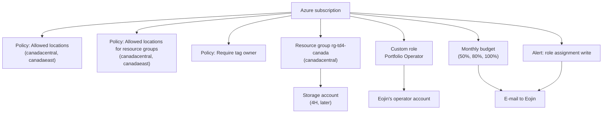

# 4E landing zone: how the pieces connect

What each arrow means:

- Subscription to the three policies: each policy is assigned at the subscription, so it applies to everything created inside it.
- Subscription to the resource group: the resource group `rg-td4-canada` (in `canadacentral`) is the folder-like container that lives in the subscription.
- Resource group to the storage account: project 4H will later put its storage account inside that resource group, and the policies decide whether the creation is allowed.
- Subscription to the custom role: the "Portfolio Operator" role is defined for this one subscription.
- Role to the operator account: the role is given to Eojin's operator account, which can then read everything and start or stop virtual machines, and do nothing else.
- Subscription to the budget and to the alert: both watch the subscription, one for spending and one for new permissions being granted.
- Budget and alert to the e-mail: when either fires, Azure sends an e-mail to Eojin.
